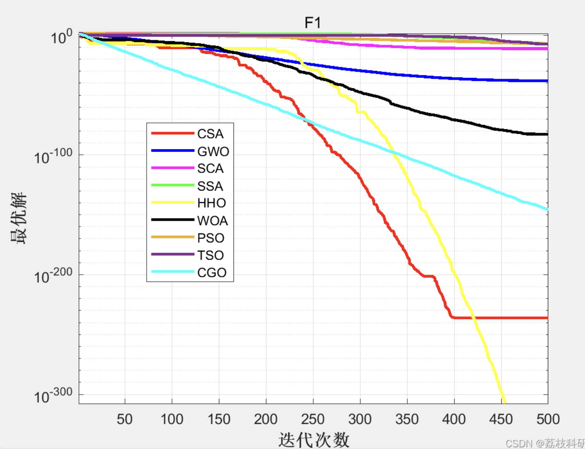

# Comparative Analysis of 9 Optimization Algorithms: CGO, SCA, GWO, CSA, SSA, HHO, WOA, PSO, TSO (Matlab)

[9 Comparisons of Optimization Algorithms]CGO, SCA, GWO, CSA, SSA, HHO, WOA, PSO, TSO Intelligent Optimization Algorithms Comparison (Matlab Code Implementation)

## Images

<!-- PAYMENT_BLOCK -->

## Get this dataset

- Payment link (Stripe): [Buy now](https://buy.stripe.com/3cs8yP7sY87d0vu9AB)
- Payment QR code: 

<!-- /PAYMENT_BLOCK -->
